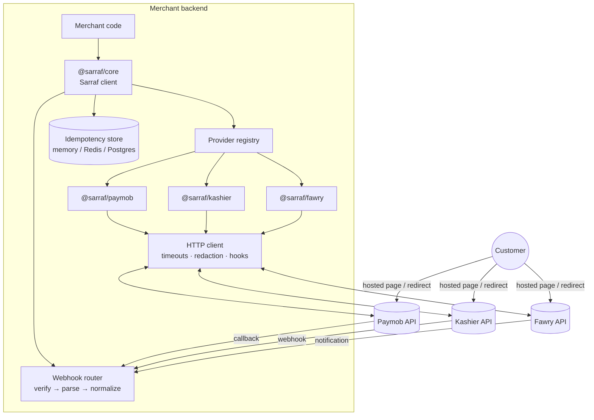
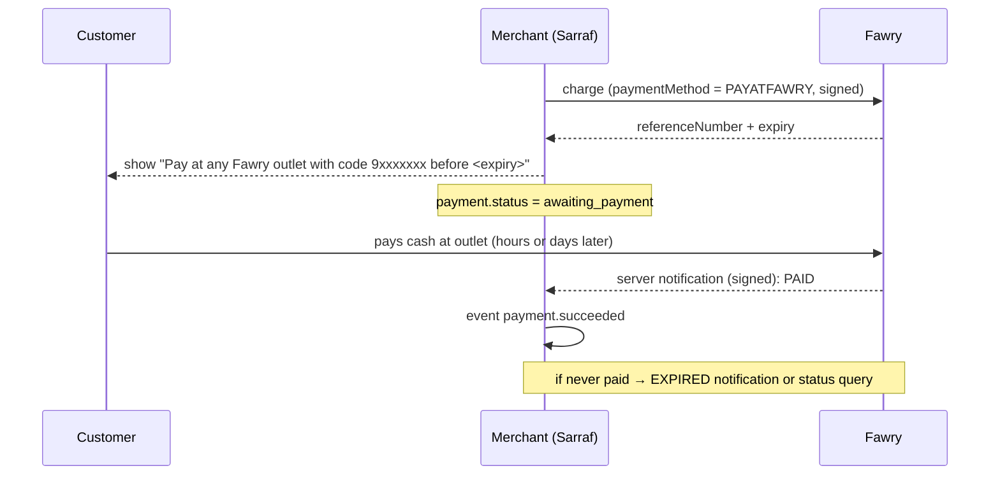

# Sarraf — One Payment API for Egypt (and then the Middle East)

**Build plan, architecture & implementation guide · v1 providers: Paymob, Kashier, Fawry**
Author: Muhammed Alaa · Status: Ready to build · Target: v1.0 in ~6 weeks, part-time

> *Sarraf* (صرّاف, "cashier") is a working name. Check npm, GitHub and the web before committing to it.

---

## 0. How to use this document

- **Sections 1–6** are the product and architecture: read once, then keep as reference.
- **Sections 7–9** are the three provider adapters: read the one you're building that week.
- **Sections 10–14** are testing, DX, open source, milestones and launch.
- Every provider detail has a **confidence tag**:
  - ✅ **Verified**: confirmed against official provider material while writing this plan (sources in §15).
  - ⚠️ **Verify**: from community sources or memory. Confirm against the official docs **and a real sandbox call** before relying on it.

Provider APIs change. **The sandbox is the source of truth.** Record what it actually does as fixtures (§10), and let tests protect you from drift.

### Progress (updated 2026-10-21)

| Milestone (§13) | State |
|---|---|
| Week 1: core | ✅ Done |
| Week 2–4: Paymob, Kashier, Fawry adapters | ✅ Implemented, documentation-based fixtures, conformance suite passing. ⚠️ items still need real sandbox fixtures (no sandbox credentials yet), so they ship as `"beta"` / `verified: false` |
| Week 5: DX & docs | ✅ `@sarraf/express`, three examples, docs site, dashboard inbox + replay |
| Week 6: launch | ⏳ Not started: v1.0.0 publish, README GIF, launch posts |
| Repo hygiene | ✅ Node 22+, zod 4, Express 5, Conventional Commits (commit-msg hook + PR title check), auto PR labels, Dependabot |

Next: record real sandbox fixtures and flip ⚠️ → ✅; Next.js / NestJS helpers (planned for v1.1, §11).

---

## 1. What we're building

An **open-source TypeScript SDK for Node.js** that lets a backend accept payments through **Paymob, Kashier and Fawry** (v1), and later Tap, HyperPay, Stripe and others, through **one interface**:

```ts
import { Sarraf } from "@sarraf/core";
import { paymob } from "@sarraf/paymob";
import { kashier } from "@sarraf/kashier";
import { fawry } from "@sarraf/fawry";

const pay = new Sarraf({
  providers: {
    paymob: paymob({
      region: "egypt",
      secretKey: process.env.PAYMOB_SECRET_KEY!,
      publicKey: process.env.PAYMOB_PUBLIC_KEY!,
      hmacSecret: process.env.PAYMOB_HMAC_SECRET!,
      integrationIds: { card: 123456, wallet: 654321 },
    }),
    kashier: kashier({
      merchantId: process.env.KASHIER_MID!,
      apiKey: process.env.KASHIER_API_KEY!,
      secretKey: process.env.KASHIER_SECRET_KEY!,
      mode: "test",
    }),
    fawry: fawry({
      merchantCode: process.env.FAWRY_MERCHANT_CODE!,
      secureKey: process.env.FAWRY_SECURE_KEY!,
      environment: "staging",
    }),
  },
});

// One call, any provider
const checkout = await pay.checkout.create({
  provider: "kashier",
  amount: { value: 250_00, currency: "EGP" },          // 250.00 EGP, integer minor units
  reference: "order_8841",
  customer: { name: "Sara Ali", email: "sara@example.com", phone: "+201001234567" },
  returnUrl: "https://shop.example.com/thanks",
  webhookUrl: "https://shop.example.com/api/webhooks/kashier",
  methods: ["card", "wallet"],
});
// → redirect customer to checkout.redirectUrl   (or show checkout.referenceCode for Fawry cash)

// One webhook shape for every provider
app.post("/api/webhooks/:provider", rawBody(), async (req, res) => {
  const event = await pay.webhooks.verifyAndParse(req.params.provider, {
    headers: req.headers, rawBody: req.rawBody, query: req.query,
  });
  res.sendStatus(200);                                   // acknowledge fast
  await queue.add("payment-event", event);               // process async, dedupe on event.id
});
```

### Why these three first
They're the core Egyptian stack: **Paymob** (cards + wallets, also KSA/UAE/Oman), **Kashier** (popular with SMEs, cards/wallets/installments), **Fawry** (cash at 30,000+ outlets via reference codes, plus cards/wallets). Most Egyptian products need at least two of them, and developers rewrite the same glue code every time.

### What it proves to employers
Integrations at depth (three very different signature schemes), SDK/API design, security, testing discipline, open-source maturity, and real adoption numbers (npm downloads, stars).

---

## 2. Ground rules (from the legal & safety review)

These are **design constraints**:

1. **SDK, not a payment service.** Merchants use their **own** provider accounts and keys. Money goes customer → provider → merchant. Sarraf never holds funds.
2. **No card data, ever.** Only hosted pages, iframes, redirects, tokens and reference codes. No Sarraf API accepts a card number or CVV.
3. **Server-side only.** `@sarraf/core` throws a clear error if imported in a browser. Public keys for client widgets are exposed through explicit helpers only.
4. **Not affiliated** with any provider: state it in README and docs; no provider logos as branding.
5. **Apache-2.0 license** (patent grant + no-warranty clause).
6. **Sandbox-only dashboard**: refuses live keys, labels every screen "Sandbox".
7. **Never auto-retry money-moving calls** (create/refund) after a timeout without an idempotency guarantee. Query status instead.

---

## 3. Architecture

### 3.1 Big picture



### 3.2 Layers (inside every adapter)

```text
adapter/
├─ config.ts       # validate options (zod), resolve base URLs per region/environment
├─ client.ts       # thin typed wrappers around raw provider endpoints (no normalization)
├─ signature.ts    # ALL hashing/HMAC logic for this provider, pure functions, 100% tested
├─ mappers.ts      # provider objects ⇄ Sarraf models (status map, money conversion)
├─ webhooks.ts     # verify + parse provider callbacks into SarrafEvent
├─ adapter.ts      # implements PaymentProvider by composing the above
└─ index.ts        # public factory: paymob(options) → PaymentProvider
```
**Rule:** `signature.ts` and `mappers.ts` are pure functions with no I/O. That's where the bugs hide, so they must be trivially unit-testable with fixtures.

### 3.3 Monorepo

```text
sarraf/
├─ packages/
│  ├─ core/        # Sarraf client, types, Money, errors, http, idempotency, webhook router, conformance tests
│  ├─ paymob/      # @sarraf/paymob
│  ├─ kashier/     # @sarraf/kashier
│  ├─ fawry/       # @sarraf/fawry
│  ├─ testing/     # @sarraf/testing: fake provider, fixture loader, signers to fake valid webhooks in tests
│  └─ express/     # @sarraf/express: rawBody middleware + webhook handler (Nest/Next helpers later)
├─ apps/
│  ├─ dashboard/   # Next.js sandbox playground + webhook inbox
│  └─ docs/        # documentation site
├─ examples/       # express-shop, nestjs-shop, nextjs-shop
├─ fixtures/       # recorded, scrubbed sandbox payloads: fixtures/<provider>/<scenario>.json
├─ scripts/        # record-fixtures.ts, scrub.ts, check-no-secrets.ts
└─ .changeset/
```
Tooling: pnpm workspaces, Turborepo, TypeScript (strict), tsup (ESM + CJS), Vitest, Biome (format + lint) + type-aware ESLint, Changesets, lefthook, commitlint.

---

## 4. Core contracts (`@sarraf/core`)

### 4.1 Provider interface

```ts
export type ProviderId = "paymob" | "kashier" | "fawry"; // extended by later adapters

export interface PaymentProvider<Id extends ProviderId = ProviderId> {
  readonly id: Id;
  readonly capabilities: Capabilities;

  createCheckout(input: CreateCheckoutInput, ctx: Ctx): Promise<Checkout>;
  getPayment(lookup: PaymentLookup, ctx: Ctx): Promise<Payment>;
  refund?(input: RefundInput, ctx: Ctx): Promise<Refund>;
  cancel?(lookup: PaymentLookup, ctx: Ctx): Promise<Payment>;      // void / cancel unpaid reference

  verifyWebhook(req: RawWebhookRequest, ctx: Ctx): Promise<VerifiedWebhook>; // throws WEBHOOK_SIGNATURE_INVALID
  parseWebhook(v: VerifiedWebhook, ctx: Ctx): Promise<SarrafEvent>;
  verifyRedirect?(query: Record<string, string>, ctx: Ctx): Promise<RedirectResult>; // returnUrl params
}

export interface Ctx { http: HttpClient; logger: Logger; now(): Date; idempotency: IdempotencyStore }
```

### 4.2 Inputs & models

```ts
type Currency = "EGP" | "SAR" | "AED" | "OMR" | "KWD" | "BHD" | "JOD" | "QAR" | "USD";
type Money = { value: number; currency: Currency };   // INTEGER minor units, never floats

type PaymentMethod = "card" | "wallet" | "cash_outlet" | "installments" | "bnpl" | "bank_transfer" | "other";

interface CreateCheckoutInput {
  provider: ProviderId;
  amount: Money;
  reference: string;                      // merchant order id: must be unique per attempt for some providers
  customer: { name?: string; email?: string; phone: string };
  items?: { name: string; unitAmount: Money; quantity: number; sku?: string }[];
  methods?: PaymentMethod[];              // default: provider default
  returnUrl?: string;
  webhookUrl?: string;
  expiresInSeconds?: number;
  locale?: "en" | "ar";
  idempotencyKey?: string;
  metadata?: Record<string, string>;
  providerOptions?: Record<string, unknown>; // typed per adapter via module augmentation
}

type CheckoutKind = "redirect" | "reference_code";
interface Checkout {
  id: string;                 // "<provider>_<providerCheckoutId>"
  provider: ProviderId;
  kind: CheckoutKind;
  redirectUrl?: string;       // kind = redirect
  referenceCode?: string;     // kind = reference_code (Fawry cash)
  expiresAt?: string;
  payment: Payment;           // initial state, usually "pending" or "awaiting_payment"
  raw: unknown;
}

type PaymentStatus =
  | "pending" | "requires_action" | "awaiting_payment"
  | "succeeded" | "failed" | "canceled" | "expired"
  | "refunded" | "partially_refunded";

interface Payment {
  id: string; provider: ProviderId; providerPaymentId: string;
  reference: string; status: PaymentStatus;
  amount: Money; amountRefunded: Money;
  method?: PaymentMethod;
  card?: { last4?: string; brand?: string };   // display-only, from provider
  failure?: { code: SarrafErrorCode; message: string; providerCode?: string };
  createdAt?: string; updatedAt?: string;
  raw: unknown;
}

type SarrafEvent = {
  id: string;                         // stable dedupe key: "<provider>:<providerEventOrTxnId>:<status>"
  type: "payment.succeeded" | "payment.failed" | "payment.pending" | "payment.expired"
      | "payment.canceled" | "refund.succeeded" | "refund.failed";
  provider: ProviderId;
  payment: Payment;
  receivedAt: string;
  raw: unknown;
};
```

### 4.3 Money (do this perfectly in week 1)

| Exponent | Currencies |
|---|---|
| 2 | EGP, SAR, AED, QAR, USD, EUR |
| **3** | **KWD, BHD, OMR, JOD** |

```ts
toMinor("250.00", "EGP") === 25000;   toMajorString(25000, "EGP") === "250.00";
toMinor("1.250", "KWD") === 1250;     toMajorString(1250, "KWD") === "1.250";
```
Per-provider format (see adapters): **Paymob = integer cents** ✅ · **Kashier = major-unit decimal string** ⚠️ · **Fawry = major units with exactly 2 decimals** ✅ (signatures break on `250` vs `250.00`).

Implement with integer/string math, not `Number` division. Property-test round-trips for every currency.

### 4.4 Errors

```ts
type SarrafErrorCode =
  | "CONFIGURATION_INVALID" | "AUTHENTICATION_FAILED" | "INVALID_REQUEST"
  | "UNSUPPORTED_CURRENCY" | "CAPABILITY_NOT_SUPPORTED" | "PAYMENT_DECLINED"
  | "DUPLICATE_REFERENCE" | "NOT_FOUND" | "RATE_LIMITED" | "PROVIDER_UNAVAILABLE"
  | "TIMEOUT_UNKNOWN_OUTCOME"            // money call timed out: query status, don't retry blindly
  | "WEBHOOK_SIGNATURE_INVALID" | "NETWORK_ERROR";

class SarrafError extends Error { code; provider?; providerCode?; retryable: boolean; raw?; }
```

### 4.5 Cross-cutting services
- **HTTP client:** `fetch`, per-request timeout (default 15s), retries **only** for GET/status calls and 429/5xx, hooks for logging, automatic **redaction** of keys, tokens, signatures, emails, phones.
- **Idempotency store:** interface + `MemoryStore` (default) + `RedisStore`. `checkout.create` and `refund` with the same `idempotencyKey` return the stored result instead of calling the provider again.
- **Webhook router:** `pay.webhooks.verifyAndParse(providerId, req)` → adapter `verifyWebhook` → `parseWebhook`. Also exposes `pay.webhooks.dedupeKey(event)`.
- **Capabilities:** `pay.capabilities("fawry")` returns the confirmed feature set. Calling an unsupported feature throws `CAPABILITY_NOT_SUPPORTED` with a docs link.
- **Conformance suite:** `runConformanceTests(adapterFactory, fixtures)`, the shared tests every adapter must pass (§10).

---

## 5. Unified payment flows

### 5.1 Redirect flow (Paymob, Kashier, Fawry card/wallet)

```mermaid
sequenceDiagram
  participant C as Customer
  participant M as Merchant backend (Sarraf)
  participant P as Provider
  M->>P: create checkout (signed / authenticated)
  P-->>M: checkout URL / client secret
  M-->>C: redirect to hosted page
  C->>P: pays (card / wallet / 3-D Secure)
  P-->>M: server webhook (signed)  ← SOURCE OF TRUTH
  P-->>C: redirect to returnUrl (+ signed query params)
  C->>M: lands on returnUrl
  M->>M: verifyRedirect() for UX only; order state comes from webhook or status query
```

**Golden rule:** the **server webhook** (or a status query) updates the order. The customer redirect is only for showing a "thank you / failed" page. Redirect params can be tampered with or never arrive.

### 5.2 Reference-code flow (Fawry cash at outlet)



### 5.3 Reconciliation (all providers)
Webhooks can be lost. Provide `pay.payments.reconcile({ provider, reference })`, which calls `getPayment` and returns the normalized status. Document a recommended cron: re-check every payment still `pending`/`awaiting_payment` older than 15 minutes.

---

## 6. Status normalization (the heart of the SDK)

Each adapter has a **status mapping table** in `mappers.ts`, exported for docs and the dashboard's "status explorer". Every row has a unit test. Tables per provider are in §7–§9.

---

## 7. Paymob adapter (`@sarraf/paymob`)

### 7.1 Credentials & config
| Option | Use | Exposure |
|---|---|---|
| `secretKey` | Create intentions (server) ✅ | Secret |
| `publicKey` (`pk_…`) | Build Unified Checkout URL / Pixel ✅ | Safe for browser |
| `hmacSecret` | Verify callbacks ✅ | Secret |
| `apiKey` | Legacy auth-token flow, needed for transaction inquiry ✅ | Secret |
| `integrationIds` | One per payment method (card, wallet…); test/live must match the key mode ✅ | Config |
| `region` | `egypt` → `https://accept.paymob.com`, `ksa` → `https://ksa.paymob.com`, `uae` → `https://uae.paymob.com`, `oman` → `https://oman.paymob.com` ✅ | Config |

Test and live use the **same base URL**; the mode comes from the keys and integration IDs ✅.

### 7.2 Create checkout (Intention API) ✅
```http
POST {base}/v1/intention/
Authorization: Token <SECRET_KEY>        ← literally "Token", not "Bearer"
Content-Type: application/json

{
  "amount": 25000,                        ← cents
  "currency": "EGP",                      ← must match the integration's currency
  "payment_methods": [123456, 654321],    ← integration IDs (ints) or method names
  "items": [{ "name": "Order 8841", "amount": 25000, "quantity": 1 }],
  "billing_data": { "first_name": "Sara", "last_name": "Ali", "email": "sara@example.com",
                    "phone_number": "+201001234567" },   ← phone_number required in practice
  "special_reference": "order_8841",      ← your reference (comes back as merchant_order_id)
  "notification_url": "https://shop.example.com/api/webhooks/paymob",
  "redirection_url": "https://shop.example.com/thanks",
  "expiration": 3600,
  "extras": { "sarraf_ref": "order_8841" }
}
```
Response (key fields): `id` (intention id), `intention_order_id`, `client_secret`, `payment_methods`, `status: "intended"` ✅.

Checkout URL ✅:
```text
{base}/unifiedcheckout/?publicKey={PUBLIC_KEY}&clientSecret={client_secret}
```
`client_secret` is **single-use**: every attempt needs a new intention ✅.

**Mapping:** `amount.value` → `amount` (already minor units). `items[].amount` must sum to `amount` (validate before calling). Missing phone → throw `INVALID_REQUEST` locally.

### 7.3 Webhook (transaction processed callback) ✅
- Paymob **POSTs** JSON to `notification_url`; the transaction is in `body.obj`; the signature arrives as the **`hmac` query parameter**.
- **Algorithm:** HMAC-**SHA512**, key = `hmacSecret`, output lowercase hex, constant-time compare.
- **Concatenate these values in exactly this order, no separator:**

```text
amount_cents, created_at, currency, error_occured, has_parent_transaction, id,
integration_id, is_3d_secure, is_auth, is_capture, is_refunded, is_standalone_payment,
is_voided, order.id, owner, pending, source_data.pan, source_data.sub_type,
source_data.type, success
```
- Booleans → `"true"` / `"false"`; numbers → plain string; values used **as received** (don't reformat dates). Note Paymob's spelling **`error_occured`**.
- ⚠️ How `null` values stringify is not documented clearly. Capture a real callback in week 2 and lock it in a fixture test.

```ts
// packages/paymob/src/signature.ts
const FIELDS = ["amount_cents","created_at","currency","error_occured","has_parent_transaction","id",
  "integration_id","is_3d_secure","is_auth","is_capture","is_refunded","is_standalone_payment",
  "is_voided","order.id","owner","pending","source_data.pan","source_data.sub_type",
  "source_data.type","success"] as const;

export function paymobTransactionHmac(obj: Record<string, unknown>, hmacSecret: string): string {
  const str = FIELDS.map((path) => stringify(get(obj, path))).join("");
  return createHmac("sha512", hmacSecret).update(str, "utf8").digest("hex");
}
const stringify = (v: unknown) => (v === null || v === undefined ? "" /* ⚠️ confirm */ : String(v));
```

- **Dedupe** on `obj.id` (transaction id) ✅. `order.id` / `special_reference` are for correlation only.
- Card-token callbacks (saved cards) use a **different field set**. Out of scope for v1; reject with a clear error.

### 7.4 Redirect (`redirection_url`)
Transaction details arrive as query params and are **not authenticated** ✅. Use for UX only; the order state comes from the POST callback or a status query. (If you add redirect HMAC verification later, confirm its field set separately ⚠️.)

### 7.5 Get payment / reconcile ✅
Uses the **legacy auth-token flow**:
```http
POST {base}/api/auth/tokens        { "api_key": "<API_KEY>" }   → { "token": "..." }   (short-lived; cache ~50 min ⚠️)
GET  {base}/api/acceptance/transactions/{transaction_id}?token=<token>
```
Same shape as callback `obj`; read `success`, `pending`, `is_voided`, `is_refunded`. Lookup **by merchant order id** exists but its exact path varies ⚠️. Confirm in the Postman collection / API explorer.

### 7.6 Refund & void ✅
```http
POST {base}/api/acceptance/void_refund/refund   Authorization: Token <SECRET_KEY>
{ "transaction_id": 12345, "amount_cents": 10000 }        ← partial refunds allowed

POST {base}/api/acceptance/void_refund/void     Authorization: Token <SECRET_KEY>
{ "transaction_id": 12345 }                               ← same-day cancel, no amount
```
Never auto-retry these after a timeout; return `TIMEOUT_UNKNOWN_OUTCOME` and let the merchant query status.

### 7.7 Status mapping
| Paymob fields | Sarraf status |
|---|---|
| `pending: true` | `pending` |
| `success: true`, `is_refunded: false`, `is_voided: false` | `succeeded` |
| `success: true`, `is_refunded: true`, refunded amount < amount | `partially_refunded` ⚠️ (confirm refunded-amount field) |
| `success: true`, `is_refunded: true`, fully refunded | `refunded` |
| `is_voided: true` | `canceled` |
| `success: false`, `pending: false` | `failed` (`error_occured`/`data.message` → `failure`) |
| Intention expired without transaction | `expired` (from status query) |

### 7.8 Capabilities (v1)
Checkout ✅ · get payment ✅ · full/partial refund ✅ · void ✅ · webhook verification ✅ · methods: card, wallet (+ others via integration IDs) · currencies: per region/integration.

### 7.9 Gotchas
- Integration ID mode must match the key mode, or intentions fail ✅.
- `items` total must equal `amount`.
- Each region has a different base URL ✅. Never hardcode Egypt.
- `notification_url` must be public HTTPS ✅. For local dev, document a tunnel (ngrok / cloudflared).

---

## 8. Kashier adapter (`@sarraf/kashier`)

### 8.1 Credentials & config
| Option | Use | Exposure |
|---|---|---|
| `merchantId` (MID, e.g. `MID-xxx-xxx`) | Identifies merchant | Public-ish |
| `apiKey` (Payment API key) | Signs the hosted-page hash; verifies redirect & webhook signatures ✅ | Secret |
| `secretKey` | Server API calls (sessions, refunds) ⚠️ confirm per endpoint | Secret |
| `mode` | `"test"` or `"live"` | Config |

### 8.2 Two ways to create a checkout. Pick one in week 3.
**A. Hosted Payment Page with order hash** ✅ (proven, used in Kashier's official demo):

```ts
// Hash = HMAC-SHA256 (hex) of the path string, keyed with the Payment API key
const path = `/?payment=${merchantId}.${orderId}.${amount}.${currency}`;   // ✅ format from official demo
// (an optional ".{customerReference}" suffix exists for saved cards ⚠️)
const hash = createHmac("sha256", apiKey).update(path).digest("hex");
```
Then redirect to the hosted page with query params ⚠️ (confirm exact names and the base URL, e.g. `https://checkout.kashier.io/`):
```text
merchantId, orderId, amount, currency, hash, mode=test|live,
merchantRedirect=<returnUrl>, serverWebhook=<webhookUrl>,
allowedMethods=card,wallet,bank_installments, display=en|ar
```
- `amount` is a **major-unit string** as used in the hash (demo uses `"20"`) ⚠️. **Use exactly the same string in the hash and the URL**; any formatting difference breaks the hash.
- `orderId` must be unique per attempt.

**B. Payment Sessions API (v3)** ⚠️ (newer):
```http
POST https://api.kashier.io/v3/payment/sessions
Authorization: <SECRET_KEY>
api-key: <API_KEY>          ← community reports both headers are required
```
Returns a session URL to redirect to. Confirm body fields, test base URL and response in the docs.

**Recommendation:** implement **A** first (fully specified, shown in Kashier's demo). Add **B** behind `providerOptions: { flow: "session" }` once confirmed.

### 8.3 Redirect verification (`merchantRedirect`) ✅ pattern / ⚠️ details
Kashier appends query params (payment status, order/transaction ids, …) **plus `signature`**. Verification per the official demo:
1. Take all query params **except `signature` and `mode`**, in the order received.
2. Join as `key=value` pairs with `&`.
3. HMAC-SHA256 with the **API key**, hex output, constant-time compare to `signature`.

Treat as UX only. The server webhook remains the source of truth.

### 8.4 Webhook verification ✅
- Kashier POSTs JSON `{ event, data }`; `data.signatureKeys` lists which fields are signed. The signature is in the **`x-kashier-signature`** header.
- Algorithm:
  1. Take `data.signatureKeys`, **sort** them.
  2. Build an object `{ key: data[key] }` for those keys.
  3. Serialize as a query string **exactly like the npm `query-string` library's `stringify`** (strict RFC 3986 encoding, arrays as repeated keys, null as a bare key). Plain `encodeURIComponent` produces mismatches on characters like `*` `(` `)`.
  4. HMAC-SHA256 with the **Payment API key**, hex, constant-time compare with the header.

```ts
// packages/kashier/src/signature.ts
import queryString from "query-string";               // exact serializer parity matters
export function kashierWebhookSignature(data: Record<string, unknown>, apiKey: string) {
  const keys = [...(data.signatureKeys as string[])].sort();
  const picked = Object.fromEntries(keys.map((k) => [k, data[k]]));
  const payload = queryString.stringify(picked);       // sorts keys by default; keep defaults
  return createHmac("sha256", apiKey).update(payload).digest("hex");
}
```
- Add a fixture test with values containing `* ( ) ' !` and Arabic text. That's where serialization bugs appear.
- Events to handle (⚠️ confirm names): `pay`, `refund`, `authorize`, `capture`, `void`.

### 8.5 Get payment / refund ⚠️
Kashier exposes order/transaction APIs (historically under `https://fep.kashier.io/v3/orders/...`, with refund as an operation on the order using the secret key). Confirm current endpoints, auth header, body (`apiOperation: "REFUND"`, `transaction.amount`, `reason`), and test base URL during week 3. Until confirmed, ship refunds as **beta** in the capability matrix.

### 8.6 Status mapping ⚠️ (confirm exact strings from fixtures)
| Kashier | Sarraf |
|---|---|
| `SUCCESS` (pay) | `succeeded` |
| `PENDING` | `pending` |
| `FAILURE` / `FAILED` | `failed` |
| refund event `SUCCESS` (partial / full) | `partially_refunded` / `refunded` |
| void | `canceled` |

### 8.7 Gotchas
- One mismatched character in `amount` or `orderId` between hash and URL → "invalid hash" on the hosted page.
- Webhook serialization parity (above) is the #1 reported integration bug.
- Test vs live MIDs/keys are different; validate `mode` against the key you were given.

---

## 9. Fawry adapter (`@sarraf/fawry`)

### 9.1 Credentials & config
| Option | Use |
|---|---|
| `merchantCode` | Identifies the merchant |
| `secureKey` | Secret used in **every** signature (SHA-256, appended at the end) ✅ |
| `environment` | `staging` → `https://atfawry.fawrystaging.com` ⚠️ · `production` → `https://www.atfawry.com` ⚠️ |

**Important:** Fawry signatures are **plain SHA-256 of a concatenated string ending with the secure key**, not HMAC ✅. Amounts in signatures use **exactly two decimals** (`10.00`) ✅.

### 9.2 Create payment: server charge API ✅ (endpoint path ⚠️)
```http
POST {base}/ECommerceWeb/Fawry/payments/charge        ⚠️ some docs show /ECommerceWeb/api/payments/charge for wallets; confirm per method
Content-Type: application/json
{
  "merchantCode": "...",
  "merchantRefNum": "order_8841",          ← unique per attempt
  "customerProfileId": "cust_77",           ← optional
  "customerMobile": "01001234567",
  "customerEmail": "sara@example.com",
  "paymentMethod": "PAYATFAWRY",            ← cash reference code (also CARD / MWALLET ⚠️)
  "amount": 250.00,
  "currencyCode": "EGP",
  "paymentExpiry": 1767225600000,           ← epoch ms ⚠️
  "description": "Order 8841",
  "chargeItems": [{ "itemId": "sku1", "description": "...", "price": 250.00, "quantity": 1 }],
  "signature": "<sha256 hex>"
}
```
**Signature** ✅:
```text
sha256( merchantCode + merchantRefNum + customerProfileId(if present, else "")
        + paymentMethod + amount(2 decimals, e.g. "250.00") + secureKey )
```
Response ⚠️ (confirm): `referenceNumber`, `expirationTime`, `statusCode` (200 = OK), `statusDescription`, `orderStatus`.

For `PAYATFAWRY`, return a `Checkout` with `kind: "reference_code"`, `referenceCode`, `expiresAt`, and payment status `awaiting_payment`.

**Card / wallet:** prefer Fawry's **hosted checkout (Express Checkout link / FawryPay plugin)** ⚠️ so card data never touches the merchant, consistent with ground rule #2. Its signature covers `merchantCode, merchantRefNum, customerProfileId, returnUrl` and each item's `itemId, quantity, price(2dp)` + `secureKey` ⚠️. Confirm the exact order in the Express Checkout docs. Ship cash (`PAYATFAWRY`) first; add hosted card/wallet second.

### 9.3 Payment status ✅ signature / ⚠️ path
```http
GET {base}/ECommerceWeb/Fawry/payments/status/v2?merchantCode=...&merchantRefNumber=order_8841&signature=...
signature = sha256( merchantCode + merchantRefNumber + secureKey )      ✅
```

### 9.4 Server notification (webhook): V2 ⚠️
Fawry POSTs a JSON notification to the URL configured on the merchant account. Known V2 fields: `requestId`, `fawryRefNumber`, `merchantRefNumber`, `customerMobile`, `customerMail`, `paymentAmount`, `orderAmount`, `fawryFees`, `orderStatus`, `paymentMethod`, `paymentTime`, `paymentRefrenceNumber` *(Fawry's spelling)*, `orderExpiryDate`, `orderItems`, `messageSignature`.

**messageSignature ⚠️ (verify with a real sandbox notification before trusting):**
```text
sha256( fawryRefNumber + merchantRefNumber
        + paymentAmount(2 decimals) + orderAmount(2 decimals)
        + orderStatus + paymentMethod
        + paymentRefrenceNumber (empty string if missing)
        + secureKey )
```
Implementation notes:
- **Preserve amount text exactly.** JSON parsers turn `250.00` into `250`; format with `toFixed(2)`-equivalent string math before hashing ✅.
- Accept both `merchantRefNum` and `merchantRefNumber` spellings defensively.
- **V1 notifications use a weaker MD5 scheme.** Don't support V1; document asking Fawry to enable V2 on the account.
- **Defense in depth:** after a valid signature, optionally re-query status (§9.3) before marking an order paid (`providerOptions.confirmWithStatusQuery = true`, default on until the signature is fully verified).

### 9.5 Refund ⚠️ / cancel ⚠️
```http
POST {base}/ECommerceWeb/Fawry/payments/refund
{ "merchantCode","referenceNumber","refundAmount": 100.00,"reason","signature" }
signature = sha256( merchantCode + referenceNumber + refundAmount(2dp) + reason(if present) + secureKey )   ⚠️
```
Cancel unpaid reference: a dedicated "cancel payment" API exists ✅ (confirm path and signature ⚠️). Map to `cancel()`.

### 9.6 Status mapping ⚠️ (confirm strings in fixtures)
| Fawry `orderStatus` | Sarraf |
|---|---|
| `NEW` / `UNPAID` | `awaiting_payment` (cash) / `pending` (card) |
| `PAID` | `succeeded` |
| `EXPIRED` | `expired` |
| `CANCELED` / `CANCELLED` | `canceled` |
| `REFUNDED` | `refunded` |
| `PARTIAL_REFUNDED` | `partially_refunded` |
| `FAILED` | `failed` |

### 9.7 Gotchas
- **Sandbox access may require merchant onboarding.** Request it in week 1.
- Reference codes can take hours or days to be paid. Set `expiresAt` and run reconciliation.
- Amount formatting is the #1 signature-mismatch cause.
- Different endpoints use **different field orders** in signatures (charge vs status vs capture vs refund) ✅. Keep one function per signature type, each with its own fixture test.

---

## 10. Testing strategy

| Level | What | How |
|---|---|---|
| Money | Round-trips for every currency incl. 3-decimal; per-provider formatting | Vitest + property tests |
| Signatures | Every signature function vs. **known-good fixtures** (real sandbox payload + expected hash) | Vitest, one file per provider |
| Tamper tests | Changed amount, changed status, wrong key, missing header, extra whitespace → must fail | Vitest |
| Mappers | Every status table row | Table-driven tests |
| Conformance | Same suite for all adapters: create → webhook succeeded → get → refund → webhook refunded, using fixtures + fake HTTP | `runConformanceTests()` in core |
| Contract (sandbox) | Real calls to Paymob / Kashier / Fawry sandboxes, nightly in CI with secrets | Vitest tag `@sandbox` |
| Types | Public API stability | `expect-type` |
| Examples | Express / Nest / Next examples build + smoke test | CI |

**Fixture recording (`scripts/record-fixtures.ts`):** run a sandbox scenario, save request/response/webhook JSON to `fixtures/<provider>/<scenario>.json`, **scrub** keys, tokens, emails, phones and PANs (`scripts/scrub.ts`), and store the **expected signature** computed with a throwaway test secret. CI runs `check-no-secrets.ts` on every PR.

**Coverage target:** 95% on `signature.ts` + `mappers.ts`, 90% overall.

---

## 11. Developer experience & dashboard

### SDK DX
- Full TypeScript types, autocomplete for providers, methods, statuses, error codes.
- Errors that teach: `CAPABILITY_NOT_SUPPORTED: Kashier refunds are beta in v1 (docs/providers/kashier#refunds)`.
- `debug: true` logs redacted requests/responses.
- ESM + CJS, Node 22+, zero runtime deps in core except `zod` (and `query-string` in the Kashier adapter).
- `@sarraf/express`: `rawBody()` middleware + `webhookHandler(pay, onEvent)`. Nest and Next helpers in v1.1.

### Sandbox dashboard (`apps/dashboard`, Next.js)
1. **Playground:** pick provider/method/amount → create checkout → open hosted page or show the Fawry reference code. Request, raw response and normalized object side by side.
2. **Webhook inbox:** live list with ✓/✗ signature result, raw payload, the **exact string that was hashed** (great for debugging), normalized event, **Replay** button.
3. **Status explorer:** each provider's mapping table.
4. **Capability matrix:** live `pay.capabilities()`.
5. Safety: rejects live keys, rate-limited, auto-deletes data after 7 days, "Sandbox, no real money" banner.

### Docs site
Quick start (5 min) · Concepts (money, statuses, webhooks, idempotency, reconciliation) · one page per provider (setup, credentials, flows, status table, gotchas, **signature recipes**) · Express/Nest/Next guides · API reference (TypeDoc) · "Not affiliated with any provider" notice.

---

## 12. Open-source setup
- Apache-2.0 · `README`, `CONTRIBUTING` ("How to add a provider" checklist mirroring §3.2), `SECURITY.md`, `CODE_OF_CONDUCT`, issue/PR templates.
- Changesets → semver + changelogs per package; GitHub Actions publish to npm **with provenance**.
- CI: lint, typecheck, tests on Node 22/24, build, examples, secret scan; nightly sandbox contract tests.
- Labels: `good first issue`, `provider: <name>`, `help wanted`. Open issues for Tap, HyperPay, Stripe, Moyasar, PayTabs, Valu, Opay.

---

## 13. Milestones (~6 weeks, part-time)

| Week | Goal | Done when |
|---|---|---|
| **0 (now)** | Accounts | Sandbox/test accounts requested from **Paymob, Kashier, Fawry** (Fawry may need business onboarding; use your agency) |
| **1** | Core | Monorepo, types, Money (all currencies), errors, HTTP + redaction, idempotency store, webhook router, `@sarraf/testing`, conformance suite skeleton, dashboard skeleton, CI green |
| **2** | **Paymob** (reference adapter) | Intention checkout, HMAC callback verification with real fixtures, auth-token status query, refund/void, status map, passes conformance suite, works in dashboard |
| **3** | **Kashier** | HPP hash checkout, redirect verification, webhook verification with serialization parity tests, status map; sessions API + refunds marked beta if unconfirmed |
| **4** | **Fawry** | PAYATFAWRY reference flow end to end, status query, V2 notification verification confirmed against a real notification, refund/cancel; hosted card checkout if time allows |
| **5** | DX & docs | `@sarraf/express`, three examples, docs site with provider pages and signature recipes, dashboard webhook inbox + replay |
| **6** | Launch | v1.0.0 on npm with provenance, public sandbox dashboard, README GIF, launch posts |

**Definition of done for each adapter:** passes the conformance suite, has real sandbox fixtures for success / failure / refund, has a docs page, and every ⚠️ item in its section is either ✅ verified or listed as "beta" in its capabilities.

---

## 14. Launch & presentation

- **README:** pitch line · 10-second GIF (same code, switching Paymob → Kashier → Fawry in the dashboard) · 10-line example · provider support table · link to docs and dashboard · "Inspired by nafezly/payments (PHP); Sarraf brings typed models, verified webhooks and contract tests to Node.js."
- **Posts:** LinkedIn (EN + AR), Egyptian developer Facebook/Discord groups, dev.to article *"Integrating Paymob, Kashier and Fawry in Node.js: one API, three signature schemes"*, r/node, Show HN.
- **SEO articles:** "Verify Paymob HMAC in Node.js", "Kashier webhook signature mismatch: the fix", "Fawry PayAtFawry reference codes with TypeScript".
- **CV line:**
  > **Sarraf (open source):** TypeScript SDK unifying Egypt's main payment gateways (Paymob, Kashier, Fawry) behind one typed API with verified, normalized webhooks and sandbox contract tests; **X npm downloads/month, Y GitHub stars**.
- **Portfolio card** in "Open source & labs": GIF, docs, repo, npm badge, and a short note on the hardest part: three incompatible signature schemes under one webhook interface.

---

## 15. Sources & verification log

Verified while writing this plan:
- Paymob official integration reference (PaymobAccept/Paymob-AI-Integration-Skill): Intention API, Unified Checkout URL, region base URLs, HMAC-SHA512 field order, transaction inquiry via auth token, refund/void endpoints.
  - https://github.com/PaymobAccept/Paymob-AI-Integration-Skill
  - …/references/intention-api.md · …/references/hmac-verification.md · …/references/advanced-features.md · …/references/transaction-inquiry.md
- Kashier official PHP demo (hosted page hash path format, HMAC-SHA256 with API key; redirect signature over query params excluding `signature`/`mode`): https://github.com/Kashier-payments/Php-Checkout-Demo
- Kashier webhook docs (sorted `signatureKeys`, query-string payload, HMAC-SHA256, `x-kashier-signature`): https://developers.kashier.io/payment/webhook/
- Fawry staging developer docs (charge signature order and 2-decimal amounts; status signature; capture signature order): https://developer.fawrystaging.com/docs/server-apis/create-payment-refno-apis

Community sources (⚠️ verify):
- Kashier webhook serialization parity issue: GitHub PRs in third-party projects referencing `query-string` stringify behaviour.
- Fawry V2 notification fields, amount formatting and V1 MD5 warning: `appssquare/payment-validator` (Packagist) and developer write-ups.
- Existing PHP precedent: https://github.com/Nafezly/payments

**Rule for the log:** when you confirm a ⚠️ item in the sandbox, change it to ✅ here and in the section, and commit the fixture that proves it.
