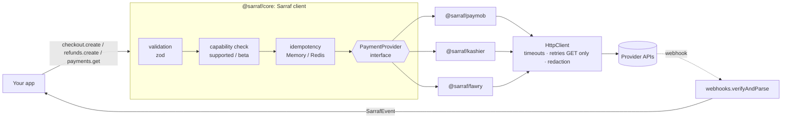

# Sarraf · صرّاف

**One payment API for Egypt, then the Middle East.** Sarraf is an open-source TypeScript SDK for Node.js. It puts **Paymob, Kashier and Fawry** behind one typed interface: one way to create a checkout, one webhook format, one status model, one error type.

[](https://github.com/sarraf-dev/sarraf/actions/workflows/ci.yml)
[](https://www.npmjs.com/package/@sarraf/core)
[](./LICENSE)

> [!IMPORTANT]
> **Sarraf is not affiliated with Paymob, Kashier, Fawry or any other payment provider.** It is an independent SDK. You bring your own provider accounts and keys, and money flows customer → provider → you. Sarraf never holds funds and never touches card data.

> [!WARNING]
> **Project status: pre-1.0.** Every signature recipe is tested against fixtures built from provider documentation, with the expected signatures computed independently of the SDK code. They have **not** all been confirmed against real sandbox traffic yet. Anything unconfirmed is marked **beta** in code (see [Capabilities and beta features](#capabilities-and-beta-features)) and needs an explicit opt-in.

---

## Table of contents

- [Why Sarraf exists](#why-sarraf-exists)
- [Packages](#packages)
- [Provider support](#provider-support)
- [Install](#install)
- [Quick start](#quick-start)
- [Core concepts](#core-concepts)
  - [Money is integers](#money-is-integers)
  - [Payment statuses](#payment-statuses)
  - [Webhooks are the source of truth](#webhooks-are-the-source-of-truth)
  - [Redirects are for the thank-you page only](#redirects-are-for-the-thank-you-page-only)
  - [Reconciliation](#reconciliation)
  - [Idempotency and never retrying money](#idempotency-and-never-retrying-money)
  - [Errors](#errors)
  - [Capabilities and beta features](#capabilities-and-beta-features)
  - [Logging and redaction](#logging-and-redaction)
  - [Server-side only](#server-side-only)
- [Provider guides](#provider-guides)
  - [Paymob](#paymob)
  - [Kashier](#kashier)
  - [Fawry](#fawry)
- [Framework integration](#framework-integration)
- [Testing your integration](#testing-your-integration)
- [API reference (summary)](#api-reference-summary)
- [How it's built](#how-its-built)
- [Sandbox dashboard](#sandbox-dashboard)
- [Development](#development)
- [Guardrails: what CI enforces and why](#guardrails-what-ci-enforces-and-why)
- [Contributing](#contributing)
- [Releasing](#releasing)
- [Security](#security)
- [Troubleshooting / FAQ](#troubleshooting--faq)
- [License](#license)

---

## Why Sarraf exists

Every payment provider in the region has its own flavour of the same thing:

- **Different signatures.** Paymob uses HMAC-SHA512 over 20 fields in a fixed order. Kashier uses HMAC-SHA256 over a `query-string`-encoded payload. Fawry uses plain SHA-256 with the secret appended. Get one character wrong and every webhook fails, or worse, every webhook passes.
- **Different amounts.** Some providers want `25000` (cents), some want `"250.00"`, some want `"250"`. Floats corrupt money.
- **Different statuses.** `success: true, pending: false`, `"SUCCESS"`, `"PAID"`, `"CAPTURED"`... all mean "you got paid", and many statuses mean something subtly different.
- **Different failure modes.** A timed-out refund might have gone through. Retrying it blindly can refund twice.

Sarraf handles that once, with tests, so your app writes this:

```ts
const checkout = await pay.checkout.create({ provider: "kashier", amount: { value: 250_00, currency: "EGP" }, ... });
const event = await pay.webhooks.verifyAndParse("kashier", req); // same shape for every provider
```

---

## Packages

| Package | What it does |
|---|---|
| [`@sarraf/core`](./packages/core) | The `Sarraf` client, models, money math (2- and 3-decimal currencies), errors, HTTP client with redaction, idempotency stores, webhook router, and the adapter conformance suite (`@sarraf/core/conformance`). Redis store at `@sarraf/core/redis`. |
| [`@sarraf/paymob`](./packages/paymob) | Intention API + Unified Checkout, HMAC-SHA512 callback and redirect verification, transaction inquiry, refund, void. Egypt, KSA, UAE, Oman. |
| [`@sarraf/kashier`](./packages/kashier) | Hosted payment page (signed URL), redirect and webhook signature verification, Payment Sessions / order lookup / refunds (beta). |
| [`@sarraf/fawry`](./packages/fawry) | PayAtFawry reference codes, status v2, V2 notification verification with status re-query, hosted card/wallet checkout, refund/cancel (beta). |
| [`@sarraf/express`](./packages/express) | `rawBody()` middleware and `webhookHandler()` for Express (and any Node `http` server). |
| [`@sarraf/next`](./packages/next) | `webhookRoute()` for App Router route handlers and `verifyRedirect()` for thank-you pages. Fetch API only, so it also fits Hono, Remix or Bun. |
| [`@sarraf/nestjs`](./packages/nestjs) | `SarrafModule`, `@InjectSarraf()`, a verified `POST /webhooks/:provider` controller and `@OnSarrafEvent()` handlers. |
| [`@sarraf/testing`](./packages/testing) | `fakeProvider()` for testing your app without network, `createMockFetch()` for adapter tests, fixture loader. |

Each adapter also ships a `/testing` subpath (`@sarraf/paymob/testing`, ...) with helpers that build correctly signed webhooks for your tests.

## Provider support

| | Paymob | Kashier | Fawry |
|---|---|---|---|
| Checkout | ✅ redirect | ✅ redirect (hosted page) · 🧪 sessions | ✅ reference code · 🧪 hosted card/wallet |
| Webhook verification | ✅ HMAC-SHA512 | ✅ HMAC-SHA256 | ✅ SHA-256 (V2) + status re-query |
| Redirect verification | ✅ (UX only) | ✅ (UX only) | — |
| Get payment / reconcile | ✅ (needs `apiKey`) | 🧪 | ✅ |
| Refund (full / partial) | ✅ | 🧪 | 🧪 |
| Void / cancel | ✅ | — | 🧪 |
| Currencies | region currency (EGP / SAR / AED / OMR) | configurable, default EGP | EGP |

✅ supported · 🧪 beta (requires `allowBeta: true`) · — not offered by the provider/adapter

---

## Install

Requires **Node.js 22+**. Install core plus the adapters you use:

```bash
npm install @sarraf/core @sarraf/paymob @sarraf/kashier @sarraf/fawry
# optional
npm install @sarraf/express          # Express helpers
npm install @sarraf/next             # Next.js App Router helpers
npm install @sarraf/nestjs           # NestJS module
npm install -D @sarraf/testing       # test helpers
```

Every package ships ESM and CommonJS builds with type declarations for both.

## Quick start

### 1. Create the client once

```ts
import { Sarraf } from "@sarraf/core";
import { paymob } from "@sarraf/paymob";
import { kashier } from "@sarraf/kashier";
import { fawry } from "@sarraf/fawry";

export const pay = new Sarraf({
  providers: {
    paymob: paymob({
      region: "egypt",
      secretKey: process.env.PAYMOB_SECRET_KEY!,
      publicKey: process.env.PAYMOB_PUBLIC_KEY!,
      hmacSecret: process.env.PAYMOB_HMAC_SECRET!,
      apiKey: process.env.PAYMOB_API_KEY,               // needed for payments.get / reconcile
      integrationIds: { card: 123456, wallet: 654321 },
    }),
    kashier: kashier({
      merchantId: process.env.KASHIER_MERCHANT_ID!,
      apiKey: process.env.KASHIER_API_KEY!,
      secretKey: process.env.KASHIER_SECRET_KEY,        // needed for server APIs (beta)
      mode: "test",
    }),
    fawry: fawry({
      merchantCode: process.env.FAWRY_MERCHANT_CODE!,
      secureKey: process.env.FAWRY_SECURE_KEY!,
      environment: "staging",
    }),
  },
});
```

You only configure the providers you use. The client is typed by them: `pay.checkout.create({ provider: "fawry", ... })` does not compile if Fawry isn't configured. Bad options throw `CONFIGURATION_INVALID` at startup with a precise message (for example `paymob(): integrationIds at least one integration id is required`). For Paymob, a test secret key paired with a live public key (or the other way round) also throws.

### 2. Create a checkout

```ts
const checkout = await pay.checkout.create({
  provider: "paymob",
  amount: { value: 250_00, currency: "EGP" },       // 250.00 EGP in minor units
  reference: "order_8841",                           // your order id
  customer: { name: "Sara Ali", email: "sara@example.com", phone: "+201001234567" },
  methods: ["card"],
  returnUrl: "https://shop.example.com/thanks",
  webhookUrl: "https://shop.example.com/api/webhooks/paymob",
  idempotencyKey: "checkout:order_8841",             // safe to call twice
});

if (checkout.kind === "redirect") redirect(checkout.redirectUrl!);
else showFawryCode(checkout.referenceCode!);         // Fawry cash: customer pays at an outlet
```

### 3. Handle webhooks (one shape for every provider)

```ts
import express from "express";
import { rawBody, webhookHandler } from "@sarraf/express";

const app = express();
app.post(
  "/api/webhooks/:provider",
  rawBody(),                                         // keep the exact bytes: signatures need them
  webhookHandler(pay, async (event) => {
    // event.type: "payment.succeeded" | "payment.failed" | "refund.succeeded" | ...
    // event.payment.reference === "order_8841"
    await queue.add("payment-event", event, { jobId: event.id }); // dedupe on event.id
  }),
);
```

Next.js (`@sarraf/next`) and NestJS (`@sarraf/nestjs`) have the same behaviour: see [Framework integration](#framework-integration). Without a helper:

```ts
const event = await pay.webhooks.verifyAndParse("kashier", {
  rawBody,                      // string | Uint8Array: the exact request body
  headers: req.headers,
  query: req.query,
});
```

An invalid signature throws `SarrafError` with code `WEBHOOK_SIGNATURE_INVALID`.

### 4. Reconcile, refund, cancel

```ts
// Webhooks can be lost: re-check pending payments on a schedule
const payment = await pay.payments.reconcile({ provider: "paymob", reference: "order_8841" });

// Full refund (omit amount) or partial refund
await pay.refunds.create({
  provider: "paymob",
  providerPaymentId: payment.providerPaymentId,
  amount: { value: 50_00, currency: "EGP" },
  idempotencyKey: "refund:order_8841:1",
});

// Void a same-day payment / cancel an unpaid Fawry code
await pay.payments.cancel({ provider: "paymob", providerPaymentId: payment.providerPaymentId });
```

---

## Core concepts

### Money is integers

All amounts are `Money`: `{ value: number; currency: Currency }`, where `value` is an **integer in minor units**.

| Human amount | `Money` |
|---|---|
| 250.00 EGP | `{ value: 25000, currency: "EGP" }` |
| 1.250 KWD | `{ value: 1250, currency: "KWD" }` (KWD, BHD, OMR, JOD have 3 decimals) |

Supported currencies: `EGP SAR AED QAR USD EUR` (2 decimals) and `KWD BHD OMR JOD` (3 decimals).

Conversions use string and `BigInt` math, never float division. They throw instead of rounding:

```ts
import { toMinor, toMajorString } from "@sarraf/core";
toMinor("250.00", "EGP");       // 25000
toMinor("1.250", "KWD");        // 1250
toMinor("0.001", "EGP");        // throws INVALID_REQUEST: more than 2 decimal places
toMajorString(25000, "EGP");    // "250.00"
```

Passing `amount: 250.5` or `amount: 250` (a bare number) is a compile error, and a non-integer `value` is rejected at runtime.

### Payment statuses

Every provider status maps to one of these:

| Status | Meaning |
|---|---|
| `pending` | Created, nothing decided yet |
| `requires_action` | Customer must do something (3-D Secure, OTP) |
| `awaiting_payment` | Waiting for offline payment (e.g. a Fawry reference code) |
| `succeeded` | Money captured. Fulfil the order. |
| `failed` | Declined or errored. `payment.failure` explains why. |
| `canceled` | Voided / canceled |
| `expired` | Reference code or session expired unpaid |
| `refunded` | Fully refunded |
| `partially_refunded` | Some of the amount refunded (`payment.amountRefunded`) |

Each adapter exports its mapping table (`PAYMOB_STATUS_TABLE`, `KASHIER_STATUS_TABLE`, `FAWRY_STATUS_TABLE`). Every row has `verified: true | false` so you can see which mappings are confirmed against real traffic.

### Webhooks are the source of truth

A `SarrafEvent` looks the same for every provider:

```ts
interface SarrafEvent {
  id: string;            // stable dedupe key: "<provider>:<providerEventOrTxnId>:<status>"
  type: "payment.succeeded" | "payment.failed" | "payment.pending" | "payment.expired"
      | "payment.canceled" | "refund.succeeded" | "refund.failed";
  provider: "paymob" | "kashier" | "fawry";
  payment: Payment;      // normalized: status, amount, amountRefunded, reference, method, ...
  receivedAt: string;
  raw: unknown;          // the provider's original payload
}
```

Rules that keep you safe:

1. **Verify with the raw body.** Signatures are computed over the exact bytes the provider sent. `express.json()` re-serializes the body and breaks Kashier and Fawry verification. Use `rawBody()` (Express), `rawBody: true` (NestJS) or `await req.text()` (Next.js route handlers).
2. **Dedupe on `event.id`.** Providers retry, so the same event can arrive more than once.
3. **Answer fast.** `webhookHandler` defaults to `mode: "handle-first"`: it runs your handler, then answers 200, and answers 500 if your handler throws so the provider retries. Use `mode: "ack-first"` only if your handler just enqueues work.
4. **Fawry is re-confirmed.** After a valid Fawry signature, the adapter re-queries the payment status before trusting it (`confirmWithStatusQuery`, default `true`).

To debug a failing signature without throwing, use `pay.webhooks.inspect(provider, req)`. It returns `{ valid, signedString, expected, received, algorithm, reason }`, where `signedString` is the exact string that was hashed.

### Redirects are for the thank-you page only

`pay.redirects.verify(provider, query)` checks the signed redirect params (Paymob, Kashier) and returns `{ authenticated, status, reference }`. Use it to show "Thanks!" or "Payment failed". **Never fulfil an order from a redirect.** Customers can close the tab, and redirect URLs can be replayed. Fulfil from webhooks or a status query.

### Reconciliation

Webhooks get lost: your server is down, the provider misconfigures a URL, a network blip. For any order still `pending` or `awaiting_payment` after about 15 minutes, call:

```ts
const payment = await pay.payments.reconcile({ provider, reference });
```

The [express-shop example](./examples/express-shop) has a `reconcilePending()` job you can copy.

### Idempotency and never retrying money

- **Status calls (GET)** are retried automatically on network errors, 429 and 5xx (default 2 retries with backoff).
- **Money-moving calls** (create checkout, refund, void) are **never** retried automatically. If one times out, Sarraf throws `TIMEOUT_UNKNOWN_OUTCOME`: the charge may or may not have happened. Query the payment status. Don't blindly retry.
- Pass `idempotencyKey` to `checkout.create` and `refunds.create`:
  - Same key + same params → the stored result is returned (no second call to the provider).
  - Same key + different params → `INVALID_REQUEST`.
  - Same key while the first call is still running, or after it ended in `TIMEOUT_UNKNOWN_OUTCOME` → `INVALID_REQUEST` with `retryable: true`. The lock is kept on purpose so a retry cannot double-charge.
- The default store is in-memory (one process). With more than one instance, use Redis:

```ts
import Redis from "ioredis";
import { RedisStore } from "@sarraf/core/redis";

const pay = new Sarraf({ providers, idempotency: new RedisStore(new Redis(process.env.REDIS_URL)) });
```

`RedisStore` works with any client that has `get`, `set(key, value, "EX", ttl, "NX")` and `del` (ioredis, node-redis v4). Completed results are kept for `idempotencyTtlSeconds` (default 24h).

### Errors

Everything Sarraf throws on purpose is a `SarrafError`:

```ts
import { isSarrafError } from "@sarraf/core";

try {
  await pay.refunds.create({ ... });
} catch (err) {
  if (isSarrafError(err, "TIMEOUT_UNKNOWN_OUTCOME")) return checkStatusLater();
  if (isSarrafError(err) && err.retryable) return retryLater();
  throw err;
}
```

| Code | When | Retryable |
|---|---|---|
| `CONFIGURATION_INVALID` | Bad adapter options, provider not configured, test/live keys mixed | no |
| `AUTHENTICATION_FAILED` | Provider returned 401/403 | no |
| `INVALID_REQUEST` | Validation failed, provider returned 4xx, idempotency key reused | no* |
| `UNSUPPORTED_CURRENCY` | Currency not supported by that provider/region | no |
| `CAPABILITY_NOT_SUPPORTED` | Feature not offered, or beta without `allowBeta` | no |
| `PAYMENT_DECLINED` | The provider declined the payment | no |
| `DUPLICATE_REFERENCE` | Provider says the reference was already used (409) | no |
| `NOT_FOUND` | Payment / order not found (404) | no |
| `RATE_LIMITED` | 429 | **yes** |
| `PROVIDER_UNAVAILABLE` | 5xx | **yes** |
| `NETWORK_ERROR` | Connection failed before a response | **yes** |
| `TIMEOUT_UNKNOWN_OUTCOME` | A money-moving call timed out. **Query status; don't retry blindly.** | no |
| `WEBHOOK_SIGNATURE_INVALID` | Signature mismatch or missing | no |

\* except the "still in progress" idempotency case, which sets `retryable: true`.

Each error also carries `provider`, `providerCode` (the provider's own error code), `status` (HTTP), `docsUrl` and `raw`. `JSON.stringify(err)` is safe to log.

### Capabilities and beta features

Every adapter declares what it can do, per feature, as `"supported" | "beta" | "unsupported"`:

```ts
pay.capabilities("fawry");
// { checkout: "supported", refund: "beta", cancel: "beta", methods: { cash_outlet: "supported", card: "beta" }, ... }
```

Calling a beta feature throws `CAPABILITY_NOT_SUPPORTED` unless you opt in:

```ts
const pay = new Sarraf({ providers, allowBeta: true });
```

"Beta" means *implemented and unit-tested, but not yet confirmed against the provider's real sandbox*. It is not a quality judgement on the provider.

### Logging and redaction

```ts
new Sarraf({
  providers,
  debug: true,                     // log every request/response (redacted) to the console
  logger: myPinoOrWinstonLogger,   // anything with debug/info/warn/error(message, meta)
  http: {
    timeoutMs: 15_000,             // default 15s per attempt
    maxRetries: 2,                 // default; GET/status calls only
    hooks: { onRequest: (e) => metrics.inc(e.operation), onResponse: (e) => trace(e) },
  },
});
```

Everything passed to logs and hooks goes through `redact()` first. Any field whose name looks sensitive (`secret`, `token`, `password`, `signature`, `hmac`, `authorization`, `api_key`, `secure_key`, `cvv`, `card_number`, `pan`, `hash`, `client_secret`, ...) is replaced with `[REDACTED]`. Emails become `s***@example.com` and phone numbers keep only the last 2 digits.

### Server-side only

`@sarraf/core` throws on import in a browser. Your secret keys must never ship to a client bundle. In Next.js, import it only from server code (route handlers, server actions, or files marked `import "server-only"`).

---

## Provider guides

The full guides live in the docs site (`apps/docs`): setup, credentials, flows, the complete status table and gotchas. This is the summary.

### Paymob

```ts
paymob({
  region: "egypt",              // "egypt" | "ksa" | "uae" | "oman" (sets base URL and currency)
  secretKey: "sk_test_...",     // creates intentions, refunds, voids
  publicKey: "pk_test_...",     // builds the Unified Checkout URL
  hmacSecret: "...",            // verifies callbacks and redirects
  apiKey: "...",                // legacy API key: transaction inquiry (getPayment / reconcile)
  integrationIds: { card: 123, wallet: 456 },  // one per method; test/live must match keys
  baseUrl: undefined,           // override (proxies, tests)
});
```

- **Checkout:** Intention API → Unified Checkout redirect URL.
- **Callback signature:** HMAC-SHA512 (hex) with `hmacSecret`, over the concatenated values of these transaction fields, in this order: `amount_cents, created_at, currency, error_occured, has_parent_transaction, id, integration_id, is_3d_secure, is_auth, is_capture, is_refunded, is_standalone_payment, is_voided, order.id, owner, pending, source_data.pan, source_data.sub_type, source_data.type, success`. The expected value arrives in the `?hmac=` query parameter.
- **Provider options:** `providerOptions: { paymentMethods, extras, billingData }`.
- ⚠️ To confirm in sandbox: how `null` fields are stringified, refund response fields, and the transaction-inquiry-by-reference path.

### Kashier

```ts
kashier({
  merchantId: "MID-123-456",
  apiKey: "...",                // Payment API key: signs the hosted page, verifies redirects/webhooks
  secretKey: "...",             // server APIs (sessions, order lookup, refunds): beta
  mode: "test",                 // "test" | "live"
  amountFormat: "fixed",        // "fixed" → "250.00", "trimmed" → "250"
  currencies: ["EGP"],
  urls: { checkout, api, fep }, // overrides
});
```

- **Checkout (default):** signed hosted payment page URL. The hash is `HMAC-SHA256(apiKey, "/?payment=<mid>.<orderId>.<amount>.<currency>")`, with `.<customerReference>` appended when given. The amount string in the hash and the URL is always identical.
- **Checkout (beta):** `providerOptions: { flow: "session" }` uses the Payment Sessions API. It isn't gated by `allowBeta`, because checkout itself is supported, but the adapter logs a warning every time it is used.
- **Webhook signature:** header `x-kashier-signature` = HMAC-SHA256 (hex) of the `data.signatureKeys` fields, sorted, serialized exactly like `query-string`'s `stringify`. Plain `encodeURIComponent` breaks on `* ( ) ' !`, and there are parity tests for this, including Arabic text.
- **Redirect signature:** every query param except `signature` and `mode`, in received order.
- **Provider options:** `providerOptions: { flow, allowedMethods, customerReference, extraParams }`.

### Fawry

```ts
fawry({
  merchantCode: "...",
  secureKey: "...",             // appended to every signature (plain SHA-256, not HMAC)
  environment: "staging",       // "staging" | "production"
  confirmWithStatusQuery: true, // re-query status after a valid notification (default true)
  language: "en-gb",            // "en-gb" | "ar-eg"
  baseUrl: undefined,
});
```

- **Checkout (default):** PayAtFawry. `checkout.kind === "reference_code"`; show `checkout.referenceCode` to the customer, who pays at an outlet. Status goes `awaiting_payment` → `succeeded` / `expired`.
- **Checkout (beta):** `methods: ["card"]` or `["wallet"]` returns a hosted redirect.
- **Signatures:** SHA-256 (hex) of concatenated fields + `secureKey`, with amounts always formatted to 2 decimals. Charge: `merchantCode + merchantRefNum + customerProfileId + paymentMethod + amount`. Status: `merchantCode + merchantRefNumber`.
- **V2 notification:** `messageSignature` = SHA-256 of `fawryRefNumber + merchantRefNumber + paymentAmount + orderAmount + orderStatus + paymentMethod + paymentRefrenceNumber + secureKey` (⚠️ to confirm). V1 notifications are rejected.
- **Phone numbers** are normalized to Fawry's local `01XXXXXXXXX` format.
- **Provider options:** `providerOptions: { customerProfileId, description }`.

---

## Framework integration

Three runnable shops live in [`examples/`](./examples). Each runs with **fake providers** when no keys are set, so you can try them immediately. In demo mode the Express and Next.js shops let you click through the whole flow:
- a fake hosted checkout where you approve or decline
- a Fawry reference-code page with a "simulate paying at an outlet" button
- live status updates driven by signed webhooks
- refunds and on-demand reconciliation

```bash
pnpm --filter example-express-shop dev     # http://localhost:3000
pnpm --filter example-nextjs-shop dev      # http://localhost:3002
```

| Framework | Example | Key point |
|---|---|---|
| Express | [`examples/express-shop`](./examples/express-shop) | `@sarraf/express`: `rawBody()` + `webhookHandler()`, a reconcile job |
| NestJS | [`examples/nestjs-shop`](./examples/nestjs-shop) | `@sarraf/nestjs`: `SarrafModule` + `@OnSarrafEvent()`, app created with `{ rawBody: true }` |
| Next.js (App Router) | [`examples/nextjs-shop`](./examples/nextjs-shop) | `@sarraf/next`: `webhookRoute()`, `verifyRedirect()`, server actions, `import "server-only"` |

All three helpers answer the same way: 200 once your handler finishes, 400 for an invalid signature, 404 for an unknown provider, and 500 when your handler throws so the provider retries.

Next.js route handler:

```ts
// app/api/webhooks/[provider]/route.ts
import { webhookRoute } from "@sarraf/next";
import { pay } from "@/lib/pay";

export const runtime = "nodejs";
export const POST = webhookRoute(pay, async (event) => {
  await applyEvent(event); // dedupe on event.id
});
```

NestJS module:

```ts
// main.ts: NestFactory.create(AppModule, { rawBody: true })
@Module({ imports: [SarrafModule.forRoot({ client: pay })], providers: [OrdersService] })
export class AppModule {}

@Injectable()
export class OrdersService {
  @OnSarrafEvent("payment.succeeded")       // POST /webhooks/:provider is registered for you
  async paid(event: SarrafEvent) { /* dedupe on event.id, fulfil the order */ }
}
```

---

## Testing your integration

### Test your app without any provider: `fakeProvider`

```ts
import { Sarraf } from "@sarraf/core";
import { fakeProvider } from "@sarraf/testing";

const paymob = fakeProvider("paymob");                           // stands in for the real adapter
const pay = new Sarraf({ providers: { paymob } });

const checkout = await pay.checkout.create({ provider: "paymob", amount: { value: 1000, currency: "EGP" }, reference: "o1", customer: { phone: "+201000000000" } });

// Simulate the provider calling your webhook
const webhook = paymob.simulate("o1", "succeeded");             // a correctly signed request
const event = await pay.webhooks.verifyAndParse("paymob", webhook);
// event.type === "payment.succeeded"
```

`fakeProvider("fawry", { checkoutKind: "reference_code" })` behaves like Fawry cash.

### Test against real provider payloads: signed webhook builders

```ts
import { paymobTransaction, signPaymobCallback } from "@sarraf/paymob/testing";
const req = signPaymobCallback(paymobTransaction({ success: true }), process.env.TEST_HMAC!);
```

Equivalent helpers: `signKashierWebhook` / `kashierWebhookData` (`@sarraf/kashier/testing`), `signFawryNotification` / `fawryNotification` (`@sarraf/fawry/testing`).

### Mock HTTP: `createMockFetch`

```ts
import { createMockFetch } from "@sarraf/testing";

const fetch = createMockFetch([
  { method: "POST", url: "/v1/intention/", respond: { status: 201, body: { id: "pi_1", client_secret: "cs" } } },
]);
const pay = new Sarraf({ providers, http: { fetch } });
// fetch.calls / fetch.callsTo("POST", "/v1/intention/") to assert on requests
```

Unmatched requests throw with a helpful message instead of reaching the network.

---

## API reference (summary)

Full generated reference: `pnpm --filter @sarraf/docs build` (TypeDoc output under `/api`).

### `new Sarraf(options)`

| Option | Type | Default | |
|---|---|---|---|
| `providers` | `{ paymob?, kashier?, fawry? }` | required | Adapter instances. Keys must match the adapter id. |
| `allowBeta` | `boolean` | `false` | Allow features marked beta |
| `idempotency` | `IdempotencyStore` | `MemoryStore` | Use `RedisStore` across instances |
| `idempotencyTtlSeconds` | `number` | `86400` | How long completed results are kept |
| `debug` | `boolean` | `false` | Log redacted HTTP traffic |
| `logger` | `Logger` | warn+error to console | `{ debug, info, warn, error }` |
| `http` | `HttpClientOptions \| HttpClient` | | `fetch`, `timeoutMs`, `maxRetries`, `hooks` |
| `now` | `() => Date` | `new Date()` | Clock (for tests) |

### Methods

| Method | Returns | |
|---|---|---|
| `checkout.create(input)` | `Checkout` | `kind: "redirect"` (`redirectUrl`) or `"reference_code"` (`referenceCode`) |
| `payments.get({ provider, providerPaymentId \| reference })` | `Payment` | Current status from the provider |
| `payments.reconcile(...)` | `Payment` | Same as `get`; name it this in scheduled jobs |
| `payments.cancel(...)` | `Payment` | Void / cancel unpaid |
| `refunds.create({ provider, providerPaymentId, amount?, reason?, idempotencyKey? })` | `Refund` | Omit `amount` for a full refund |
| `webhooks.verifyAndParse(provider, req)` | `SarrafEvent` | Throws `WEBHOOK_SIGNATURE_INVALID` |
| `webhooks.inspect(provider, req)` | `WebhookInspection` | Debug info, never throws on mismatch |
| `webhooks.dedupeKey(event)` | `string` | `event.id` |
| `redirects.verify(provider, query)` | `RedirectResult` | UX only |
| `capabilities(provider)` | `Capabilities` | |
| `provider(id)` | `PaymentProvider` | The raw adapter |
| `providerIds` | `ProviderId[]` | Configured providers |

### `CreateCheckoutInput`

| Field | Type | |
|---|---|---|
| `provider` | `"paymob" \| "kashier" \| "fawry"` | required |
| `amount` | `Money` | required, integer minor units |
| `reference` | `string` | required, your order id |
| `customer` | `{ phone; name?; email? }` | required |
| `items` | `{ name; unitAmount: Money; quantity; sku? }[]` | must sum to `amount` |
| `methods` | `("card" \| "wallet" \| "cash_outlet" \| "installments" \| "bnpl" \| "bank_transfer" \| "other")[]` | |
| `returnUrl`, `webhookUrl` | `string` | |
| `expiresInSeconds` | `number` | |
| `locale` | `"en" \| "ar"` | |
| `idempotencyKey` | `string` | |
| `metadata` | `Record<string, string>` | |
| `providerOptions` | typed per provider | see each provider guide |

---

## How it's built

### Architecture



1. **`@sarraf/core`** knows nothing about any specific provider. It owns the models, validation, capability checks, idempotency, money math, errors, the HTTP client and the `PaymentProvider` interface.
2. **Adapters** implement `PaymentProvider` and register themselves in core's type registries through TypeScript module augmentation. That is how `providerOptions` gets a different type for each provider, and how a third-party adapter (say `@acme/sarraf-tap`) can plug in without changing core.
3. **The HTTP client** is a thin `fetch` wrapper (Node 22+ has `fetch` built in). It adds per-request timeouts, retries only safe calls, maps a timeout on a money call to `TIMEOUT_UNKNOWN_OUTCOME`, and redacts everything it logs. Inject your own `fetch` for tests or proxies.

### Adapter anatomy

Every adapter has the same files, with the same responsibilities:

| File | Responsibility | Pure? |
|---|---|---|
| `config.ts` | zod schema for options, base URLs, test/live detection | yes |
| `signature.ts` | **All** hashing, one function per signature type. Returns `{ signedString, signature }`. | yes |
| `mappers.ts` | Provider objects ⇄ Sarraf models, status mapping table, amount formatting | yes |
| `client.ts` | Thin typed wrappers around provider endpoints. Money calls set `moneyMoving: true`. | I/O |
| `webhooks.ts` | `inspect` → `verify` → `parse` | mostly |
| `adapter.ts` | Implements `PaymentProvider`, declares `capabilities` | I/O |
| `testing.ts` | Builds correctly signed payloads for tests (published as `/testing`) | yes |

Keeping `signature.ts` and `mappers.ts` pure (no I/O, no clock, no randomness) is what makes them testable to 95%+ coverage, and lets the dashboard show the exact string that was hashed.

### Repository layout

```text
packages/
  core/           client, models, money, errors, http, redact, idempotency, conformance suite
  paymob/         adapter (reference implementation for new adapters)
  kashier/        adapter
  fawry/          adapter
  express/        rawBody() + webhookHandler()
  next/           webhookRoute() + verifyRedirect() for the App Router
  nestjs/         SarrafModule, @OnSarrafEvent()
  testing/        fakeProvider, createMockFetch, fixture loader
apps/
  dashboard/      Next.js sandbox playground + webhook inbox (never accepts live keys)
  docs/           Astro Starlight docs site + TypeDoc API reference
examples/
  express-shop/   nestjs-shop/   nextjs-shop/
fixtures/         scrubbed payloads: fixtures/<provider>/<scenario>.json
scripts/          check-no-secrets, record-fixtures, scrub
tests/sandbox/    contract tests against real sandboxes (skipped without credentials)
```

### How correctness is established

- **Signature fixtures** (`fixtures/<provider>/*.json`) contain a payload, a test secret, the exact `signedString` and the `expectedSignature`. The expected signatures were computed with a separate script using plain `node:crypto`, not the SDK. If the SDK's recipe is wrong, the test fails instead of agreeing with itself.
- **Tamper tests:** each signature is rejected when the amount, the status or the key changes, when the signature is missing, or when extra whitespace is added.
- **Property tests** (fast-check) check money round-trips for every currency.
- **Conformance suite** (`@sarraf/core/conformance`): every adapter runs the same lifecycle: create → webhook succeeded → get → refund → webhook refunded, plus tamper and idempotency checks.
- **Sandbox contract tests** (`pnpm test:sandbox`) make real calls when `.env.sandbox` exists, and run nightly in CI.
- **Recorded fixtures** (`pnpm record-fixtures`) capture real webhooks, verify them with your real secret, then scrub PII and re-sign with a throwaway secret so they can be committed.

### Toolchain

pnpm workspaces · Turborepo · TypeScript 6 (strictest settings, see below) · tsup (ESM + CJS + `.d.ts`/`.d.cts`) · Vitest + v8 coverage + fast-check + expect-type · Biome (format + lint) · ESLint with typescript-eslint (type-aware rules only) · publint · are-the-types-wrong · Changesets · lefthook.

---

## Sandbox dashboard

`apps/dashboard` is a local Next.js app for working with provider sandboxes:

- **Playground:** create a checkout and see the request, the raw provider response and the normalized result side by side.
- **Webhook inbox:** every webhook received, with ✓/✗ signature status, the **exact string that was hashed**, expected vs received signatures, and a **Replay** button. Entries are kept for 7 days in `apps/dashboard/data/inbox.json`.
- **Status explorer:** every provider's status mapping table.
- **Capability matrix.**

```bash
cp .env.sandbox.example .env.sandbox   # sandbox keys only
pnpm --filter @sarraf/dashboard dev    # http://localhost:4545
cloudflared tunnel --url http://localhost:4545   # point provider webhooks at <tunnel>/webhooks/<provider>
```

Without credentials, it runs on fake providers. It **refuses to start with live keys** and rate-limits its API routes.

---

## Development

### Prerequisites

- Node.js 22.12+ (see `.nvmrc`; the published packages support 22+)
- pnpm 12: `npm i -g pnpm@12` or `corepack enable`

### Setup

```bash
git clone https://github.com/sarraf-dev/sarraf.git
cd sarraf
pnpm install          # also installs git hooks (lefthook)
pnpm build
pnpm check            # everything CI runs, locally
```

### Scripts

| Command | What it does |
|---|---|
| `pnpm build` | Build all packages, apps and examples (Turborepo, cached) |
| `pnpm test` | Unit, signature, conformance and type tests, with coverage thresholds |
| `pnpm typecheck` | `tsc` for every workspace, plus `scripts/` and `tests/` |
| `pnpm lint` | Biome (format + lint) and ESLint (type-aware). **Run after `pnpm build`.** |
| `pnpm lint:fix` | Apply safe Biome and ESLint fixes |
| `pnpm format` | Format everything with Biome |
| `pnpm lint:packages` | `publint --strict` on every published package |
| `pnpm check-secrets` | Scan the repo for credentials and for any value from your `.env.sandbox` |
| `pnpm check` | Build, then all of the above, in CI order |
| `pnpm test:scripts` | Tests for `scripts/` |
| `pnpm test:sandbox` | Real contract tests against provider sandboxes (needs `.env.sandbox`) |
| `pnpm record-fixtures ...` | Record real sandbox payloads as scrubbed fixtures (see below) |
| `pnpm changeset` | Describe your change for the changelog and version bump |

Run one package: `pnpm --filter @sarraf/paymob test`. Run one test file: `cd packages/paymob && pnpm vitest run test/signature.test.ts`.

### Working with real sandboxes

```bash
cp .env.sandbox.example .env.sandbox   # fill in SANDBOX / TEST credentials only
pnpm test:sandbox                      # real calls; each provider is skipped if its keys are missing

# capture real webhooks as fixtures
pnpm record-fixtures webhook --port 4545
cloudflared tunnel --url http://localhost:4545     # set SANDBOX_PUBLIC_URL to the tunnel URL
pnpm record-fixtures checkout paymob               # prints a URL to pay with a sandbox card
pnpm record-fixtures status paymob <reference|id>
```

The recorder and the dashboard both default to port 4545, so run one at a time. `.env.sandbox` is gitignored, and `pnpm check-secrets` fails if any of its values appear in a tracked file. **Never paste keys into issues, PRs or chat.**

---

## Guardrails: what CI enforces and why

Many people will touch this code, and it moves money. Guardrails catch mistakes before review. If one blocks you, the fix is almost always in this table.

### TypeScript (`tsconfig.base.json`)

| Setting | What it catches | How to satisfy it |
|---|---|---|
| `strict` | implicit `any`, unchecked `null` | type it; narrow it |
| `noUncheckedIndexedAccess` | `arr[0]` / `record[key]` may be `undefined` | check before use, or use `?? default` |
| `exactOptionalPropertyTypes` | `{ a?: string }` silently receiving `undefined` | declare optional fields as `a?: string \| undefined` (the house style) |
| `noImplicitReturns` | a code path that forgets to return | return on every path |
| `noFallthroughCasesInSwitch` | missing `break` | add `break` / `return` |
| `noUnusedLocals`, `noUnusedParameters` | dead code | delete it, or prefix a parameter with `_` |
| `noImplicitOverride` | accidental method shadowing | add `override` |
| `useUnknownInCatchVariables` | treating `catch (e)` as `any` | narrow with `isSarrafError(e)` / `e instanceof Error` |

### Biome (`biome.json`)

Formatting (2 spaces, 110 columns, LF) and lint. Notable rules beyond the recommended set: no `any`, `import type` for type-only imports, `node:` protocol for built-ins, no unused imports or variables, no empty blocks (write a comment saying why it's empty), no `==`, no focused tests (`it.only`), no `console` in published packages (use the injected `Logger`), no `!` non-null assertions in published packages, and no default exports in published packages.

### ESLint (`eslint.config.js`, type-aware, `packages/*/src` only)

| Rule | Why it matters in a payments SDK |
|---|---|
| `no-floating-promises`, `no-misused-promises`, `await-thenable` | A forgotten `await` on a refund or idempotency write silently loses errors |
| `switch-exhaustiveness-check` | Adding a `PaymentStatus` must update every `switch` over it |
| `no-unsafe-*`, `no-explicit-any` | `any` from a JSON body must not leak into typed models |
| `no-base-to-string`, `restrict-template-expressions` | `String(obj)` would sign `"[object Object]"`. Use `str()` from core, which returns `undefined` for non-scalars. |
| `only-throw-error`, `prefer-promise-reject-errors` | Callers rely on `instanceof Error` / `SarrafError` |
| `explicit-module-boundary-types` | Exported functions declare return types, so public types don't change by accident |
| `ban-ts-comment` | `@ts-ignore` is banned; `@ts-expect-error` needs a written reason |

ESLint reads the built `.d.ts` files of sibling packages, so run `pnpm build` first.

### Tests

- **Coverage thresholds** (enforced in every package's `vitest.config.ts`): 90% statements, functions and lines and 85% branches overall. **95%** on `signature.ts` and `mappers.ts` in each adapter, and on `money.ts` in core.
- **Public API snapshots** (`test/public-api.test.ts`): adding, removing or renaming an export changes a snapshot, so the change is visible in review. If it's intentional, run `pnpm vitest run -u` in that package and add a changeset. Removing or renaming an export is a **major** change.
- **Type tests** (`packages/paymob/test/types.test.ts`): `@ts-expect-error` lines prove that bad input (unknown provider, bare-number amounts, wrong currency, wrong `providerOptions`) does **not** compile. If you loosen a type, `pnpm typecheck` fails.
- In CI (`CI=true`), missing snapshots fail instead of being written.

### Packaging

- **publint** checks that `package.json` `exports`, `main`, `types` and `files` point at real files and are consistent.
- **are-the-types-wrong** (CI, Linux) checks that ESM and CommonJS consumers both get correct types: each package ships `.d.ts` for `import` and `.d.cts` for `require`.

### Secrets

`pnpm check-secrets` (pre-commit hook and CI) fails on live/test key patterns, private keys, JWT-like tokens, GitHub/npm/AWS tokens, and any value from your local `.env.sandbox`.

### Git hooks (lefthook, installed by `pnpm install`)

- **pre-commit:** Biome on staged files, secret scan
- **commit-msg:** commitlint ([Conventional Commits](https://www.conventionalcommits.org), rules in `commitlint.config.js`)
- **pre-push:** typecheck, then ESLint (sequential: ESLint reads the `dist/*.d.ts` that typecheck rebuilds)

To skip them in an emergency: `LEFTHOOK=0 git commit ...`. CI runs the same checks anyway.

### CI (`.github/workflows/ci.yml`)

| Job | Runs |
|---|---|
| Test (Node 22 / 24) | build packages → typecheck + tests (coverage, snapshots) |
| Quality | `biome ci`, secret scan, full build, ESLint (`--max-warnings 0`), typecheck everything, all tests, publint, attw, lockfile up to date |
| Changeset (PRs) | Fails when a published package changed without a changeset |
| PR title (`pr-title.yml`) | The title must be a Conventional Commit (`type(scope): subject`), since it becomes the squash commit on `main` |
| PR labels (`pr-labels.yml`) | Adds area labels from changed files (`.github/labeler.yml`) and a type label from the title |
| Sandbox (nightly, `sandbox.yml`) | Real contract tests with repository secrets |
| Release (`release.yml`, `main`) | Changesets "Version Packages" PR, then npm publish with provenance |

Dependabot opens weekly npm and monthly GitHub Actions updates, titled `chore(deps): …` / `ci(deps): …` so they pass the title check.

`CODEOWNERS` requires a maintainer review on every change, and an extra reviewer on `money.ts`, `signature.ts` and `mappers.ts`.

---

## Contributing

Read [CONTRIBUTING.md](./CONTRIBUTING.md). In short:

1. Fork, branch, `pnpm install`.
2. Make the change **with tests** in the same PR.
3. `pnpm check` must pass.
4. `pnpm changeset` for any change to a published package.
5. Title the PR as a Conventional Commit, e.g. `fix(kashier): sort keys before signing` (checked in CI).
6. Fill in the PR template, including how you verified the change.

**Adding a provider?** CONTRIBUTING has a step-by-step checklist. Copy `packages/paymob`, follow the [adapter anatomy](#adapter-anatomy), mark everything unconfirmed as `"beta"`, and pass the conformance suite.

**Confirmed a ⚠️ item against a real sandbox?** Record the fixture, lock it in with a test, flip `"beta"` → `"supported"` / `verified: true`, and update the docs page. That is one of the most valuable contributions right now.

## Releasing

Releases use [Changesets](https://github.com/changesets/changesets):

1. Each PR adds a changeset (`pnpm changeset`) describing the change and its semver bump.
2. On `main`, the release workflow opens a "Version Packages" PR that bumps versions and writes changelogs.
3. Merging that PR publishes to npm with [provenance](https://docs.npmjs.com/generating-provenance-statements).

## Security

Please **do not** open public issues for vulnerabilities. See [SECURITY.md](./SECURITY.md) for private reporting. Signature-verification bypasses, amount tampering and secret leakage are treated as critical.

## Troubleshooting / FAQ

**Every webhook fails with `WEBHOOK_SIGNATURE_INVALID`.**
You're probably verifying a re-serialized body. Pass the raw bytes (`rawBody()` in Express, `rawBody: true` in NestJS, `await req.text()` in Next.js). Then call `pay.webhooks.inspect(...)` and compare `signedString` with what you expect. Also check that you used the right secret: Paymob's *HMAC secret* (not the secret key), Kashier's *Payment API key*, Fawry's *secure key*.

**`CAPABILITY_NOT_SUPPORTED: ... is beta in this version`.**
That feature hasn't been confirmed against a real sandbox. Pass `allowBeta: true` if you accept that, and please report back whether it worked.

**`CONFIGURATION_INVALID: paymob(): secretKey is a test key but publicKey is a live key`.**
Your Paymob keys come from different modes. Use all test keys (and test integration ids) or all live ones.

**`TIMEOUT_UNKNOWN_OUTCOME` on a refund.**
The provider didn't answer in time. The refund may have happened. Call `pay.payments.get(...)` and check `amountRefunded` before trying again.

**`@sarraf/core is server-side only` in Next.js.**
You imported a module that imports `@sarraf/core` into a client component. Move it to a route handler or server action, and add `import "server-only"` to the module.

**ESLint reports "error typed value" or can't find types.**
Run `pnpm build` first. ESLint resolves sibling packages through their built `dist/*.d.ts`.

**A public-api snapshot test fails.**
You changed what a package exports. If that's intended, run `pnpm vitest run -u` in that package and add a changeset with the right bump.

## License

[Apache-2.0](./LICENSE). "Paymob", "Kashier" and "Fawry" are trademarks of their respective owners and are used here only to describe compatibility.
